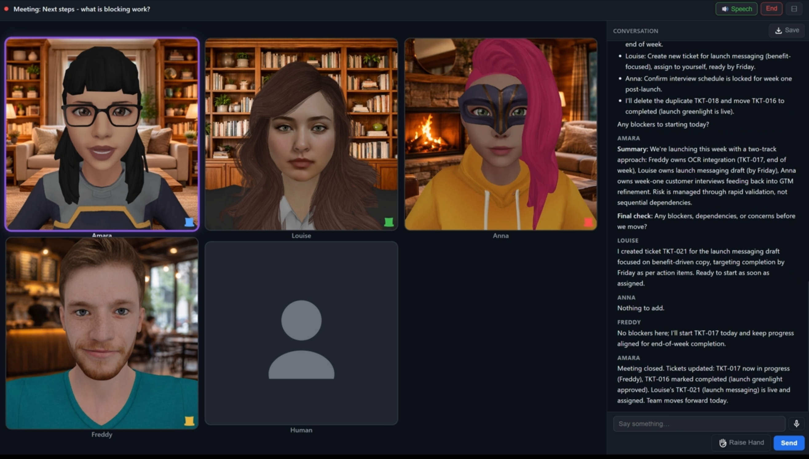

# HATS — AI agents that disagree to make better decisions

Don't ask one AI, start running a team.

Run meetings, plan work, and stress-test ideas with a team of AI agents that think differently — and challenge each other on purpose.

Most AI tools give you one answer.
HATS gives you a panel of perspectives.

## What makes HATS different?

HATS is inspired by the Six Thinking Hats framework — but implemented as a real multi-agent system with structured disagreement.

Each agent has a role:

⚪ White Hat — facts, gaps, assumptions

🔴 Red Hat — human impact, intuition

⚫ Black Hat — risks, failure modes

🟡 Yellow Hat — upside, opportunity

🟢 Green Hat — creativity, alternatives

🔵 Blue Hat — facilitation, synthesis

**They don’t just respond — they debate.**

## Why this matters

LLMs tend to:

- agree with you
- sound confident even when wrong
- miss blind spots

HATS fixes that by:

- introducing structured conflict
- forcing multiple perspectives
- simulating real team dynamics

### Example use cases

- Run a product planning meeting
- Stress-test a startup idea
- Explore trade-offs in architecture decisions
- Replace async brainstorming sessions

## Watch 6 AI agents plan a startup and argue about it

Click for a demo video:
[](https://youtu.be/-oQs3qht9CU)

## Architecture highlights

- Multi-agent orchestration
- Per-agent model selection:
- OpenAI / Claude / Gemini
- Local support via Ollama / LM Studio
- Token + cost tracking per agent
- Voice + 3D avatar support

## Live Meetings with Faces and Voices

When a meeting starts, HATS opens a stage of animated 3D avatars rendered in real time using Three.js. Each agent speaks aloud via Piper TTS with
per-agent voice models. Lip sync is driven by Rhubarb, mapping phonetic audio timing to ARKit visemes so mouths move in sync with speech.

![Agent Config[]](docs/images/agent_config.png)

Five meeting types are supported — Standup, Sprint Planning, Retrospective, Review, and Ad Hoc — all schedulable in advance via a built-in calendar or
launched instantly on demand. Humans participate directly, taking turns in the conversation. The full transcript can be downloaded as Markdown when
the meeting ends.

## A Kanban Board That Works Itself

HATS includes a six-column Kanban board — Backlog, Ready, In Progress, Blocked, Review, Done — with full drag-and-drop. When a ticket moves to In
Progress, it is automatically dispatched to the assigned agent as a live task. When a blocker is resolved, dependent tickets are automatically
unblocked and advanced. Tickets assigned to the human team lead are highlighted in orange so nothing falls through the cracks.

Agents interact with the board through the Kanban MCP server, creating, moving, and commenting on tickets as part of their normal workflow.

## MCP and Tools

Through the Model Context Protocol \(MCP), HATS ships integrations across five categories:

|Category|Tools|
|-|-|
|Productivity|Kanban, Memory (knowledge graph), Slack|
|Files & Documents|Filesystem, Excel, Word, PDF, PowerPoint|
|Web|Brave Search, Browser (Playwright)|
|Databases|SQLite, PostgreSQL|
|Development|GitHub|

All servers are togglable from the UI and report live connection status and credential requirements.

## Project-Scoped, Multi-Team

Every HATS project is isolated — its own Kanban board, meeting calendar, agent configurations, sources/ and outputs/ file folders, telemetry log, and
state snapshot. Projects can be created, switched, and loaded without restarting. A project goal set by the team lead is automatically injected into
every agent's system prompt to keep all thinking anchored to the objective.

## The Dashboard

The HATS web UI is a four-panel dashboard:

- Agents — Live status, communication overlay, add/configure agents
- Active Board — Kanban columns with real-time updates and drag-and-drop
- Tools — MCP server controls, CLI, file upload/download, tool explorer
- Backlog & Calendar — Unstarted tickets and weekly/daily/agenda calendar views

A persistent progress bar below the header shows the project goal alongside a three-segment ticket progress indicator (Done / Active / Backlog) that
updates live as work moves through the board.

![Dashboard[]](docs/images/dashboard.png)

HATS is built on Node.js with a TypeScript backend, Three.js avatar rendering, and a plain
HTML/CSS/JS frontend requiring no build step.

## Getting started

```bash
git clone https://github.com/rockcat/HATS.git
cd HATS
npm install
cp .env.example .env     # add at least one LLM provider key

npm run services         # the Agent Template Library, Project Server and the rest
npm run dev              # the team runner, in another terminal
```

Open the dashboard at <http://localhost:3001>. The [full guide](docs/README.md) covers voices, avatars, MCP servers and everything else.

To install on a server from published Docker images instead, see [deploy/](deploy/README.md).

## What's in this repository

| Folder | What it is |
| --- | --- |
| `server/` | The team runner: agents, meetings, the board, tools, and the HTTP API (port 3001) |
| `apps/web/` | The runner's dashboard |
| `apps/` | The services, one folder each: Agent Template Library, Project Server, Project Designer, runner manager, auth, speech, companion and more |
| `packages/` | Code they share, imported as `@hats/*`: contracts, clients, core, auth, service-kit, speech-core |
| `deploy/` | Installers and the compose file for a machine that runs the published images |
| `docs/` | Guides, architecture and API documents |

```bash
npm test             # every test, across the runner, services and packages
npm run typecheck
```

The HTTP APIs are documented in [docs/API.md](docs/API.md), and a running runner serves them all at `/api-docs`.
