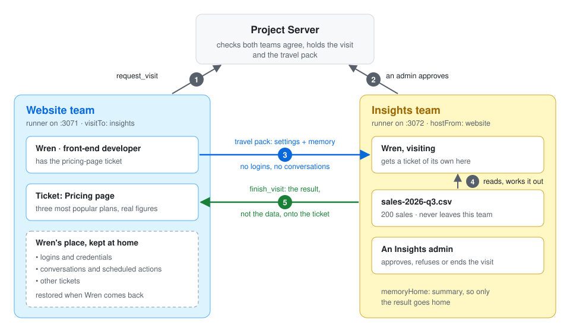
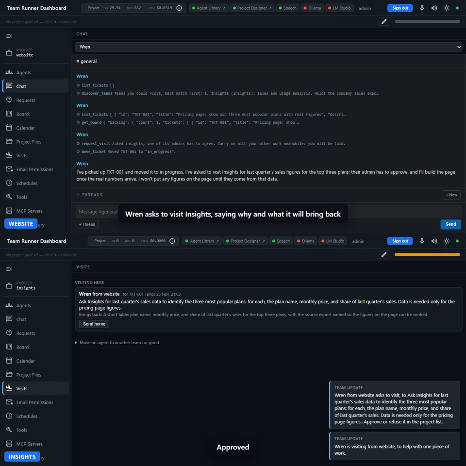
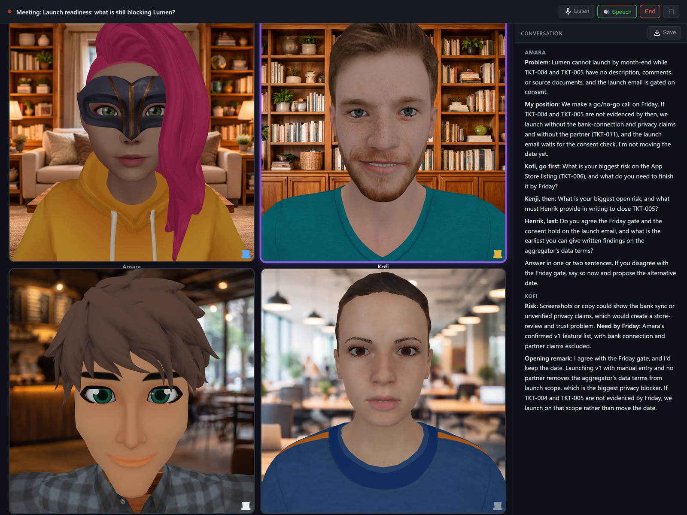
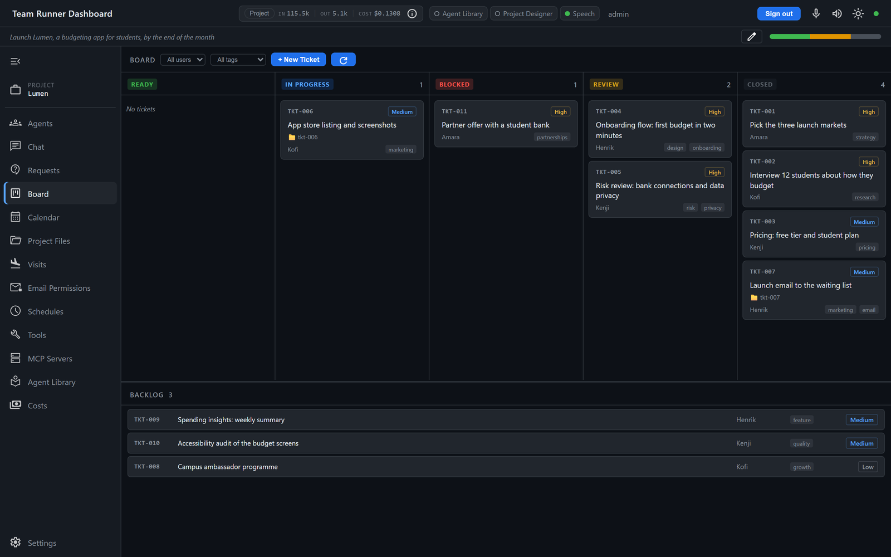
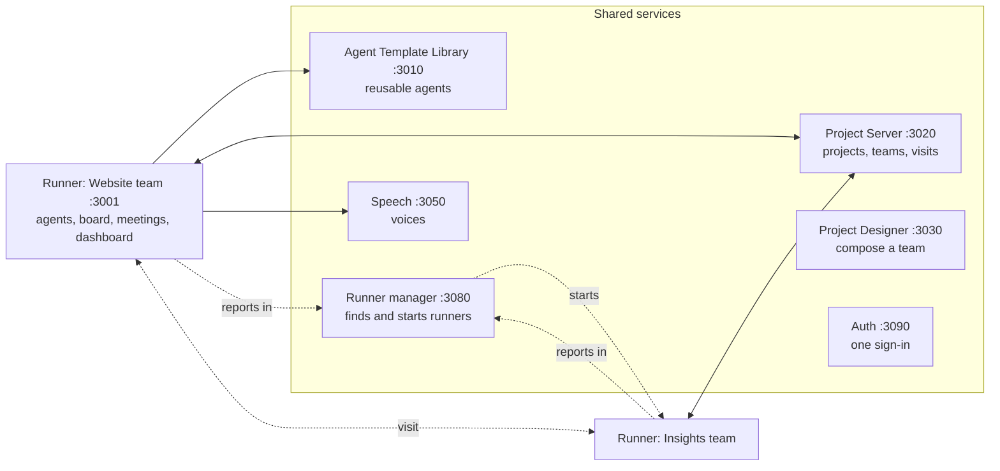

# HATS — teams of AI agents that think differently, and work together

Don't ask one AI. Run a team.

HATS gives you a team of AI agents, each with its own role, personality, model, memory and tools. They plan work on a Kanban board, hold meetings with faces and voices, argue on purpose, and get things done. You lead the team, and they ask you when they need you.

Run one team on your laptop, or many teams across machines, each in its own project. When one team needs something only another team has, an agent can **visit** that team, do the work there, and come home with the answer.

- **Agents that disagree on purpose.** Roles based on the Six Thinking Hats: facts, feelings, risks, benefits, ideas and process.
- **A board that runs itself.** Moving a ticket to In Progress hands it to its agent as a task.
- **Meetings with faces and voices.** 3D avatars, a voice for each agent, and mouths that move with the words.
- **Agents that travel.** One team lends an agent to another to use what only that team has, and only the result comes back.
- **Your models.** Claude, GPT, Gemini, or local models through Ollama and LM Studio, chosen per agent, with what each one costs.
- **Real tools.** Email, calendars, files, a web browser, search, Google Workspace and more, through MCP.

[](https://youtu.be/-oQs3qht9CU)

*Six agents plan a startup and argue about it. Click for the video.*

## Agents that visit other teams

Most multi-agent systems are one team in one place. In HATS, every agent has a **home team**, and teams can lend each other agents.

Say the Website team needs real sales figures for its pricing page, and only the Insights team has the sales data. Copying the file across would put the raw data somewhere it shouldn't be. Instead:

1. **Wren, Website's developer, asks to visit Insights.** It says why (the ticket it is working on) and what it will bring back.
2. **Both teams have to agree.** Website allows visits to Insights, Insights hosts visitors from Website, and an Insights admin approves this particular visit.
3. **Wren travels light.** It takes its settings and memory. Its logins, conversations and scheduled actions stay at home.
4. **At Insights, Wren gets a ticket of its own**, reads the sales file there, and works out the figures.
5. **Wren comes home with the result**, which lands on its ticket as a comment. The sales file never leaves Insights.



Visits are built to be safe by default:

- **Only the answer travels.** The host decides what the visitor remembers when it leaves.
- **Nothing is allowed unless both sides say so**, and the host can require an admin to approve each visit.
- **A visitor uses only what the host gives it.** Its own logins stay at home.
- **Visits end.** Each has a deadline. The home team can recall its agent and the host can send it home at any time. If its ticket is closed while it is away, it is called back.

Agents find teams to visit by what they offer, and an admin can also move an agent to another team for good. Today visits work between teams in one installation, on one machine or several. Visits between installations run by different people, over the internet, are designed and come next.

**Watch it happen:** a 52-second recording of a real run, with Website above and Insights below.

[](docs/visit-demo/recording/visit-demo.mp4)

To run the demo yourself, see [the visiting agents demo](docs/visit-demo/README.md). The design is in [team-visits.md](docs/team-visits.md).

## What a team can do

### Think differently

Each agent wears one or more of the Six Thinking Hats:

| Hat | Brings |
| --- | --- |
| ⚪ White | Facts, gaps and assumptions |
| 🔴 Red | Human impact and intuition |
| ⚫ Black | Risks and failure modes |
| 🟡 Yellow | Upside and opportunity |
| 🟢 Green | Creativity and alternatives |
| 🔵 Blue | Facilitation and the final call |

LLMs tend to agree with you and sound sure when they're wrong. A team built from different hats challenges itself, so you see the blind spots before you commit.

### Run the work

- **A Kanban board** with six columns, from Backlog to Done. Tickets go to their agents as tasks, a resolved blocker frees the tickets waiting on it, and tickets for you are highlighted.
- **Meetings:** standups, sprint planning, retrospectives, reviews and ad hoc, scheduled or on demand. You take part, and can download the transcript.
- **Chat** with the team or with one agent, in threads.
- **Talk instead of typing.** Listen mode sends what you say to the open chat or meeting.
- **Scheduled actions,** cron-style, for things an agent should do every morning or every Friday.
- **Requests and approvals.** Agents ask you when they need a decision, and before they email anyone new.



*A launch-readiness meeting. Amara, the Blue Hat, sets a go/no-go gate and asks each agent for their biggest risk; Kofi, speaking, agrees and adds a condition.*

### Remember and stay organised

- **Memory:** each agent keeps its own.
- **A calendar** for each agent, as a real `.ics` file, that sends and answers invitations by email.
- **Project files** in an explorer, with previews of documents, spreadsheets, CSV, images and sandboxed HTML.
- **People:** agents can recognise who they are talking to through a camera, only with consent.

### Use real tools

Tools come through the Model Context Protocol (MCP), and each one can be switched on for the whole team or for one agent:

| Category | Tools |
| --- | --- |
| Productivity | Memory, Slack, Google Workspace (Gmail, Calendar, Drive, Chat, Contacts), Microsoft 365 |
| Email and messaging | IMAP and POP3 email, WhatsApp, X, Threads, LinkedIn |
| Files and documents | Filesystem, Excel, Word, PDF, PowerPoint, SFTP |
| Web | Brave Search, a Playwright browser |
| Data and development | SQLite, PostgreSQL, GitHub |

Agents find the tools they need by searching, so a long tool list doesn't crowd every prompt. External agents such as Claude Code can join a team as members.

### Keep an eye on cost

Every call is counted by agent, model and project, with prices fetched from the providers. Each agent can have an hourly budget, and pauses when it reaches it.



*The dashboard: one section at a time from the menu on the left, here the board.*

## How it fits together

HATS is a **runner** for each team, and a set of shared **services**.



- **The Team Runner** holds one team: its agents, board, meetings, chat and tools. It serves the dashboard on port 3001.
- **The Agent Template Library** holds reusable agents. A team takes a copy and can tailor it.
- **The Project Server** holds each project's definition: its goal, its team, the tools it shares, and visits between teams.
- **The Project Designer** is where you put a team together.
- **The runner manager** knows every runner in the installation, starts one per project, and helps agents find teams to visit.
- **The auth service** gives one sign-in for every runner.
- **The Speech Service** runs the voices (Piper), so many runners can share them.

Everything is optional. With no services running, a runner falls back to local files and works on its own, so you can start with one runner and add the rest when you need them.

Every service publishes an OpenAPI document, and a running runner shows them all at `/api-docs`. The runner's **Embodiment API** gives an agent a face, a voice and a conversation in any web page or app. The Companion app is one example: a single agent in a browser tab that can see through the camera and hear through the microphone.

More detail: [SERVICES.md](docs/SERVICES.md), [ARCHITECTURE.md](docs/ARCHITECTURE.md) and [API.md](docs/API.md).

## Getting started

You need Node.js 22.13 or later (24 is recommended: the email tools need it), and a key for at least one model provider, or a local model through Ollama or LM Studio.

```bash
git clone https://github.com/rockcat/HATS.git
cd HATS
npm install
cp .env.example .env     # add at least one LLM provider key

npm run services         # the Agent Template Library, Project Server and the rest
npm run dev              # the team runner, in another terminal
```

Open the dashboard at <http://localhost:3001>. To try the runner on its own, `npm run start:standalone` needs no services.

The [full guide](docs/README.md) covers voices, avatars, lip sync and MCP servers. To install on a server from published Docker images, see [deploy/](deploy/README.md). To run several teams at once, see [MULTIPLE-PROJECTS.md](docs/MULTIPLE-PROJECTS.md).

## What's in this repository

| Folder | What it is |
| --- | --- |
| `server/` | The team runner: agents, meetings, the board, tools and the HTTP API |
| `apps/web/` | The runner's dashboard |
| `apps/` | The services, one folder each: Agent Template Library, Project Server, Project Designer, runner manager, auth, speech, Companion and more |
| `packages/` | Code they share, imported as `@hats/*` |
| `deploy/` | Installers and the compose file for a machine that runs the published images |
| `docs/` | Guides, architecture and API documents |

```bash
npm test             # every test, across the runner, services and packages
npm run typecheck
```

HATS is built with Node.js and TypeScript, Three.js for the avatars, and a plain HTML, CSS and JavaScript dashboard with no build step.

## Licence

HATS is free for non-commercial use under the [HATS Non-Commercial License](LICENSE.txt). Commercial use needs a licence from Ely House 25 Ltd; the licence says how to ask.
