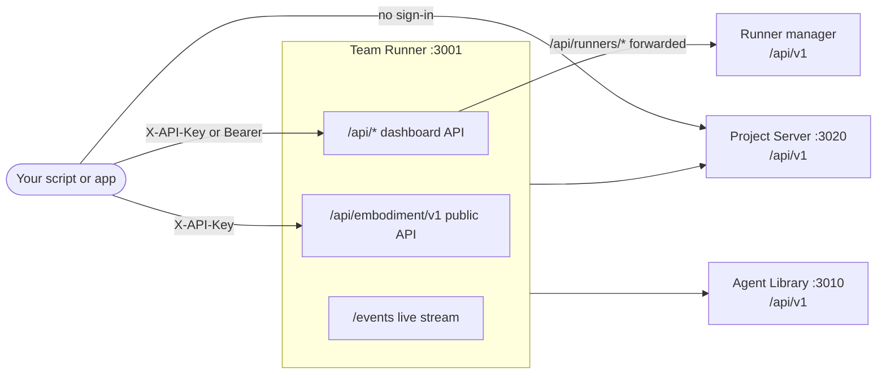

# HATS APIs

Everything the dashboard does, it does over HTTP, so scripts can do it too.
[visit-demo/seed.mjs](visit-demo/seed.mjs) is a working example: it creates
two teams on the Project Server, then signs in to each runner to upload a file
and add a ticket.

This page covers:

- what each service is for;
- how to sign in to a runner;
- the calls you will most likely need, with examples;
- every route the runner serves.

For how the services fit together, see [SERVICES.md](SERVICES.md).

## The services



| Service | Default address | Sign-in | Spec |
| --- | --- | --- | --- |
| **Team Runner**, dashboard API | `http://localhost:3001/api/…` | Yes | None. This page is the reference. |
| **Team Runner**, Embodiment API | `http://localhost:3001/api/embodiment/v1/…` | Yes | [embodiment.openapi.yaml](../packages/contracts/openapi/embodiment.openapi.yaml) |
| **Project Server** | `http://localhost:3020/api/v1/…` | No | [project-server.openapi.yaml](../packages/contracts/openapi/project-server.openapi.yaml) |
| **Agent Library** | `http://localhost:3010/api/v1/…` | No | [agent-library.openapi.yaml](../packages/contracts/openapi/agent-library.openapi.yaml) |

**Which API to use:**

- **Embodiment API:** a stable, versioned contract for apps that talk to agents,
  such as a phone app, a kiosk or an avatar. Use it when you are building
  something that should keep working as HATS changes. See
  [SERVICES.md](SERVICES.md#the-embodiment-api).
- **Dashboard API (`/api/…`):** what the dashboard itself uses. It covers
  everything, including the board, files, meetings, settings and users, but it
  is not versioned and can change with the dashboard. Use it for scripts and
  tools that live in this repository.
- **Project Server:** holds project definitions: the team, the goal and the
  settings. It also coordinates visits and moves between teams. A runner reads
  its project from here when it starts.

The Project Server and Agent Library ask for no sign-in. Keep them on a network
you trust.

## Signing in to a runner

Every `/api/*` route and `/events` needs a sign-in. Without one the runner
answers `401 {"error":"Not authenticated"}`. Only two routes are open: the
login itself, and the mobile pairing confirmation (`GET /api/auth/pair/…`).

There are two ways to sign in.

**1. An API key, sent as `X-API-Key`.** This is best for scripts and other
services. Create a key in the dashboard's Users panel, or with
[scripts/issue-api-key.mjs](../scripts/issue-api-key.mjs).

```bash
curl -H "X-API-Key: $HATS_API_KEY" http://localhost:3001/api/project
```

A key belongs to the runner that issued it. A second runner with its own data
folder will not know it, unless the runners share sign-in through an auth
service (`AUTH_SERVICE_URL`).

**2. A username and password, swapped for a session token.**

```bash
curl -X POST http://localhost:3001/api/auth/login \
  -H "Content-Type: application/json" \
  -d '{"username":"admin","password":"…"}'
# → {"ok":true,"token":"…","user":{…}}

curl -H "Authorization: Bearer <token>" http://localhost:3001/api/project
```

The login also sets a cookie, which is how the dashboard stays signed in.

Some routes are for admins only and answer `403` otherwise. These include
deciding on visits, moving agents, and creating users.

## Common tasks

The examples use `$RUNNER` for a runner's address (for example
`http://localhost:3001`) and `$AUTH` for one of the headers above.

### What is this runner running?

```bash
curl -H "$AUTH" $RUNNER/api/project
```

The answer includes the project's `id`, name and goal. `GET /api/projects`
lists every project the runner can see.

### Talk to an agent

```bash
curl -X POST -H "$AUTH" -H "Content-Type: application/json" $RUNNER/api/cli \
  -d '{"line":"@Poppy what is on the board today?","threadId":"general"}'
# → {"output":"→ Sent to Poppy"}
```

`/api/cli` takes the same lines as the dashboard's command box:

| Line | Does |
| --- | --- |
| `@Name message` | Sends a message to an agent. `threadId` picks the conversation and defaults to the agent's #general. |
| `task Name: description` | Gives an agent a task. `task Name [folder]: …` also names the project folder. |
| `reply Name: message` | Answers an agent that asked you a question. |
| `resume` | Restarts unfinished tasks and tickets. |

The call returns as soon as the message is accepted. The agent's reply comes
later, on `/events` (see below).

### Add a ticket to the board

```bash
curl -X POST -H "$AUTH" -H "Content-Type: application/json" $RUNNER/api/kanban/tickets \
  -d '{"title":"Fix the pricing page","description":"…","priority":"high",
       "column":"backlog","assignee":"Wren","tags":["web"]}'
# → 201 with the ticket, whose id is TKT-001, TKT-002, …
```

- Only `title` is required.
- `column` defaults to `backlog` and `priority` to `medium`.
- A ticket with the same title (ignoring case) is refused with `409`. The
  answer includes it as `existing`, which makes re-running a seed script safe.
- A ticket created in `in_progress` with an `assignee` is started straight away.

| To | Call |
| --- | --- |
| List every ticket | `GET /api/kanban/tickets` → `{tickets}` |
| Read the board by column | `GET /api/kanban?includeBacklog=true` |
| Change a ticket | `PATCH /api/kanban/tickets/{id}` with any of `title`, `description`, `priority`, `column`, `assignee`, `tags`, `blockedBy`, `longRunning`, `closedReason` |
| Comment on one | `POST /api/kanban/tickets/{id}/comments` with `{author?, text}` (the assignee is told) |

### Give the team a file

```bash
curl -X POST -H "$AUTH" -H "X-Filename: sales.csv" -H "Content-Type: text/csv" \
  --data-binary @sales.csv $RUNNER/api/project/upload
# → 201 {"ok":true,"path":"sources/sales.csv"}
```

The body is the raw file, not a form. The name comes from the `X-Filename`
header, and the file is saved under the project's `sources/` folder.

| To | Call |
| --- | --- |
| List the files | `GET /api/project/files` → `{sources, outputs, tickets}` |
| Download one | `GET /api/project/file?path=outputs/report.md` |
| Download them all | `GET /api/project/files.zip` |

### Follow what happens, live

`GET /events` is a [server-sent events](https://developer.mozilla.org/docs/Web/API/Server-sent_events)
stream. Each message is JSON with a `type`.

```bash
curl -N -H "$AUTH" $RUNNER/events
```

| Types | About |
| --- | --- |
| `init` | Everything, once, on connecting |
| `agent_update`, `agent_stream`, `cli_output` | Agents' state, and what they say |
| `kanban_update`, `board_update` | The board |
| `files_update` | Project files |
| `meeting_started`, `meeting_turn`, `meeting_human_turn`, `meeting_hand_raised`, `meeting_closed`, `scheduled_meetings_update` | Meetings |
| `requests_update` | Agents' questions for you |
| `team_news`, `telemetry_update`, `tools_update`, `catalogue_update`, `email_allowlist_update`, `google_auth_status` | Everything else |

This stream is internal and can change. If you need a stable stream, use the
Embodiment API's `GET /api/embodiment/v1/events`, which has a small fixed set
of event types.

### Create a team, on the Project Server

```bash
PS=http://localhost:3020
curl -X POST $PS/api/v1/projects -H "Content-Type: application/json" \
  -d '{"id":"website","name":"Website","goal":"Ship the new pricing page"}'
curl -X PATCH $PS/api/v1/projects/website -H "Content-Type: application/json" \
  -d '{"settings":{"visits":{"visitTo":["insights"]}}}'
curl -X POST $PS/api/v1/projects/website/team -H "Content-Type: application/json" \
  -d '{"agent":{ …a deployed agent… }}'
```

- Creating a project also creates its folder, with `sources/` and `outputs/`.
- `DELETE /api/v1/projects/{id}?purge=true` removes the definition and its
  folder.
- A deployed agent is described by
  [deployed-agent.schema.json](../packages/contracts/schemas/deployed-agent.schema.json), also served live
  at `/api/v1/schemas/deployedAgent`. `seed.mjs` builds one in its `TEAMS` list.
- A PATCH replaces a top-level field rather than merging into it. That is why
  `seed.mjs` reads the project's `settings` first and sends them back with its
  changes.

The runner running that project picks up the changes from the Project Server's
`/api/v1/events` stream.

## Runner reference

Every route below is under `http://<runner>:3001` and needs a sign-in. The
source is in [server/src/api/](../server/src/api/), and routes are tried in the
order [api-server.ts](../server/src/api/api-server.ts) lists them.

### Sign-in and users

| Method | Path | Does |
| --- | --- | --- |
| POST | `/api/auth/login` | Swaps `{username, password}` for `{token, user}`. Open to all. |
| POST | `/api/auth/logout` | Ends the session |
| GET | `/api/auth/me` | Who is signed in |
| POST | `/api/auth/pair/generate` | Starts pairing a phone |
| GET | `/api/auth/pair/{token}` | The phone confirms pairing. Open to all. |
| GET, POST | `/api/users` | List users, or create one with `{username, password, role}` (admin) |
| PUT, DELETE | `/api/users/{id}` | Change or remove a user |
| DELETE | `/api/users/{id}/api-keys/{keyId}` | Revoke an API key |

When `AUTH_SERVICE_URL` is set, the runner forwards all of these to that auth
service, so several runners share one set of users.

### Talking and meetings

| Method | Path | Does |
| --- | --- | --- |
| POST | `/api/cli` | Runs a command-box line. See [Talk to an agent](#talk-to-an-agent). |
| GET | `/events` | The live stream. See [Follow what happens](#follow-what-happens-live). |
| POST | `/api/meetings/start` | Starts a meeting now |
| GET | `/api/meetings/{id}/minutes` | A meeting's minutes |
| GET, POST | `/api/scheduled-meetings` | List, or schedule a meeting |
| POST | `/api/scheduled-meetings/{id}/launch` | Starts a scheduled meeting now |
| POST | `/api/scheduled-meetings/{id}/cancel` | Cancels one |
| DELETE | `/api/scheduled-meetings/{id}` | Removes one |
| GET | `/api/human-requests` | Agents' open questions for you |
| POST | `/api/human-requests/{id}/respond` | Answers one |
| POST | `/api/human-requests/{id}/dismiss` | Dismisses one |
| DELETE | `/api/human-requests/{id}` | Removes one |
| DELETE | `/api/human-requests/answered` | Clears every answered question |

### The board

| Method | Path | Does |
| --- | --- | --- |
| GET | `/api/kanban` | The board by column. `?includeBacklog=true` includes the backlog. |
| GET, POST | `/api/kanban/tickets` | List tickets, or add one |
| PATCH | `/api/kanban/tickets/{id}` | Changes a ticket, including moving it to another column |
| POST | `/api/kanban/tickets/{id}/comments` | Comments on a ticket |

### The project

| Method | Path | Does |
| --- | --- | --- |
| GET | `/api/project` | The project this runner is running |
| GET | `/api/projects` | Every project it can see |
| POST | `/api/project/switch` | Runs a different project, unless the runner is locked to one |
| GET, PUT | `/api/project/goal` | Read or set the goal |
| GET, PUT | `/api/project/human-name` | What the agents call you |
| POST | `/api/project/clear` | Clears the project's runtime state |
| POST | `/api/project/add-agent` | Adds an agent to this project |
| GET | `/api/project/files` | `{sources, outputs, tickets}` |
| GET | `/api/project/file?path=…` | One file |
| GET | `/api/project/files.zip` | Every file, zipped |
| POST | `/api/project/upload` | Adds a file to `sources/` (raw body, `X-Filename` header) |
| POST | `/api/project/open-folder` | Opens the folder on the runner's machine |
| GET | `/api/projects/{id}/export` | Exports a whole project |
| POST | `/api/projects/import` | Imports one |

### Agents

`{name}` is the agent's name.

| Method | Path | Does |
| --- | --- | --- |
| POST | `/api/agents` | Adds an agent to the team |
| DELETE | `/api/agents/{name}` | Removes one |
| PATCH | `/api/agents/{name}/…` | Changes one setting: `name`, `identity`, `specialisation`, `hat`, `prompt`, `config`, `limits`, `voice`, `email`, `avatar`, `background`, `mcp-servers` |
| GET | `/api/agents/{name}/memory` | What the agent remembers |
| GET | `/api/agents/{name}/prompt-preview` | Its full system prompt, as the model sees it |
| GET | `/api/prompt-preview` | The same, for an agent not yet added |
| GET | `/api/agents/{name}/personal-mcp` | Its own MCP servers |
| PUT, DELETE | `/api/agents/{name}/personal-mcp/{server}` | Adds or removes one |
| PUT | `/api/agents/{name}/scheduled-actions` | Sets its scheduled actions |
| GET | `/api/agents/{name}/export` | Exports an agent |
| POST | `/api/agents/{name}/duplicate`, `/send`, `/to-library` | Copies it, sends it to another runner, or saves it to the Agent Library |
| POST | `/api/agents/import` | Imports an agent |
| POST | `/api/agents/external/callback` | Where external agents report back |
| GET | `/api/personas` | The personas you can start an agent from |
| GET, POST | `/api/global-agents` | Agents shared by every project |
| PATCH, DELETE | `/api/global-agents/{id}` | Changes or removes one |
| PUT | `/api/global-agents/{id}/scheduled-actions` | Sets its scheduled actions |

### Visits and moves

These answer `404` when the runner has no Project Server.

| Method | Path | Does |
| --- | --- | --- |
| GET | `/api/visits` | Visits involving this team |
| POST | `/api/visits/{id}/approve`, `/refuse`, `/recall`, `/end` | Decides on a visit, or brings the agent home, with `{note?}` (admin) |
| GET | `/api/moves/targets` | Teams an agent may move to |
| POST | `/api/moves` | Moves an agent to another team for good, with `{agent, to, note?}` (admin) |

See [visit-demo](visit-demo/README.md) for visits end to end.

### Schedules

| Method | Path | Does |
| --- | --- | --- |
| GET, POST | `/api/agenda` | An agent's agenda, `?agent=Name`, or add an entry with `{agentName, label, description}` plus one of `intervalMinutes`, `cron` or `delayMinutes` |
| PATCH, DELETE | `/api/agenda/{id}` | Changes or removes an entry |
| POST | `/api/agenda/{id}/run` | Runs it now |
| GET, POST | `/api/scheduled-actions` | List or add a scheduled action |
| PATCH, DELETE | `/api/scheduled-actions/{id}` | Changes or removes one |
| POST | `/api/scheduled-actions/{id}/run` | Runs it now |

### Tools, models and costs

| Method | Path | Does |
| --- | --- | --- |
| GET | `/api/mcp/tools` | Tools the agents can use now |
| GET, POST | `/api/mcp/catalogue` | The MCP catalogue, or add a server to it |
| PATCH, DELETE | `/api/mcp/catalogue/{id}` | Changes or removes a server |
| POST | `/api/mcp/enable`, `/api/mcp/disable` | Turns a server on or off |
| GET | `/api/providers` | Model providers, and which have keys |
| GET | `/api/providers/models` | Their models |
| GET | `/api/pricing` | Model prices |
| POST | `/api/pricing/refresh` | Fetches prices again |
| GET | `/api/telemetry/all` | Usage and costs |

### Speech and images

| Method | Path | Does |
| --- | --- | --- |
| GET | `/api/voices` | Voices available |
| POST | `/api/speech/synthesise` | `{text, voice?, speakerName?}` → audio. Needs the Speech Service. |
| POST | `/api/speech/preview` | A sample of a voice |
| POST | `/api/speech/transcribe` | Recorded audio → `{text}`. Needs `OPENAI_API_KEY`. |
| GET | `/api/images/backgrounds` | Background images |
| POST | `/api/images/generate` | Generates one |

### Settings and status

| Method | Path | Does |
| --- | --- | --- |
| GET | `/api/services` | Which services are up |
| GET, POST | `/api/env` | Read or change the runner's settings |
| GET, POST | `/api/email-allowlist` | Who agents may email |
| PATCH, DELETE | `/api/email-allowlist/{id}` | Changes or removes an entry |
| GET | `/api/auth/google/start`, `/api/auth/google/agent/start` | Connects a Google account, for the team or one agent |
| GET | `/api/auth/google/callback` | Where Google sends you back |
| GET | `/api/auth/google/status`, `/api/auth/google/agent/status` | Whether one is connected |
| DELETE | `/api/auth/google`, `/api/auth/google/agent` | Disconnects it |
| any | `/api/runners/…` | Forwarded to the runner manager's `/api/v1/runners/…`, when `RUNNER_MANAGER_URL` is set |

## Project Server reference

All under `http://<project-server>:3020`. The full detail, including request
and response shapes, is in
[project-server.openapi.yaml](../packages/contracts/openapi/project-server.openapi.yaml),
also served live at `/api/v1/openapi.yaml`.

| Method | Path | Does |
| --- | --- | --- |
| GET | `/api/v1/health` | Is it up? |
| GET | `/api/v1/schemas/{name}` | A JSON Schema: `project` or `deployedAgent` |
| GET, POST | `/api/v1/projects` | List projects, or create one |
| GET, PUT, PATCH | `/api/v1/projects/{id}` | Read, replace or update a project |
| DELETE | `/api/v1/projects/{id}` | Removes it. `?purge=true` also deletes its folder. |
| GET, POST | `/api/v1/projects/{id}/team` | List the team, or add `{agent}` |
| PATCH, DELETE | `/api/v1/projects/{id}/team/{instanceId}` | Changes or removes an agent |
| GET, PUT | `/api/v1/active` | Which project a runner should load |
| GET | `/api/v1/events` | A stream of project changes |
| GET, POST | `/api/v1/visits` | List visits (`?project=…&open=true`), or request one |
| GET | `/api/v1/visits/{id}` | One visit |
| POST | `/api/v1/visits/{id}/{step}` | Moves it on: `approve`, `refuse`, `cancel`, `leave`, `return`, `home` |
| GET | `/api/v1/visits/{id}/pack/{out\|back}` | Its travel pack |

Runners also use these routes, which are not in the spec yet:

| Method | Path | Does |
| --- | --- | --- |
| POST | `/api/v1/moves` | Moves an agent to another team for good |
| GET | `/api/v1/moves/{id}/pack` | The moving agent's pack |
| POST | `/api/v1/moves/{id}/done` | The new team has it running |

The runner manager has its own routes: `/api/v1/teams`, used for
`discover_teams`, and `/api/v1/runners/heartbeat`, `/goodbye` and others, used
for the project switcher.

## Keeping this page right

The runner has no OpenAPI spec, so this page is its reference. When you add a
route to a router in `server/src/api/`, add a row here too.

This command lists every route, to compare with the tables above:

```bash
grep -rnoE "pathname(\.match\(|\.startsWith\(| === )[^&]*&& method === '[A-Z]+'" server/src/api packages/auth/src
```

The command misses routes written in other styles, such as
[visit-router.ts](../server/src/api/visit-router.ts) and the transfer routers,
so check those by hand.
