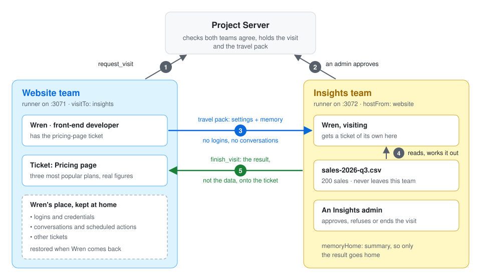
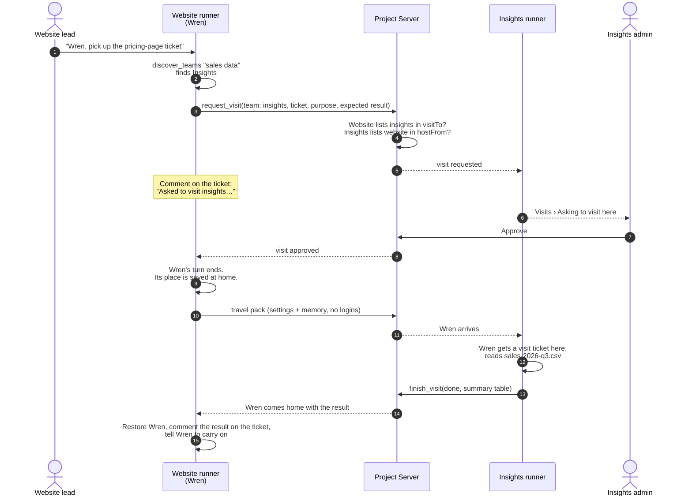
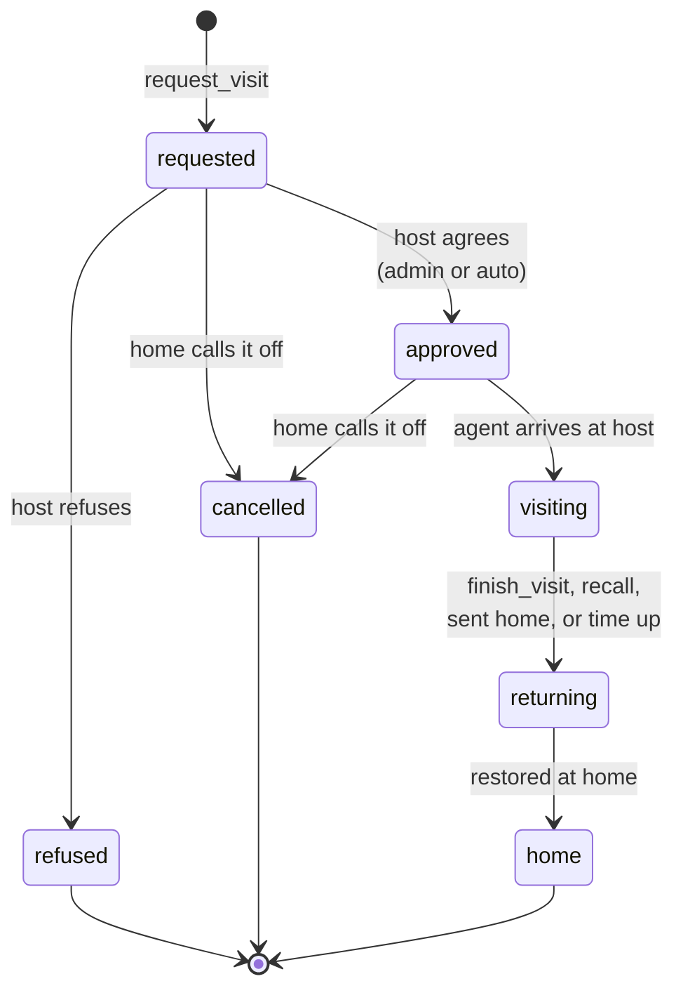
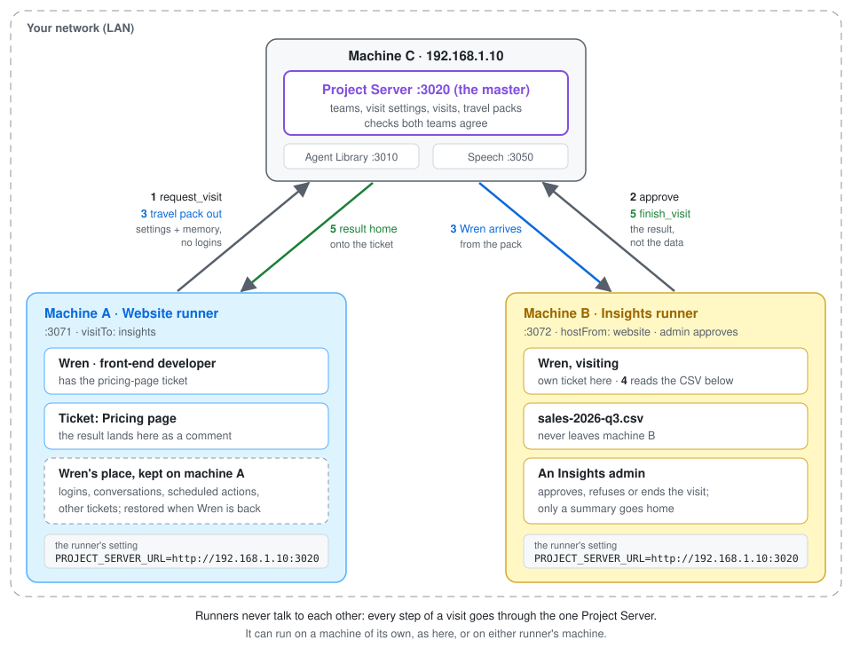

# Visiting agents: a demo

This demo shows an agent from one team **visiting** another team. It goes there to use something only that team has, then brings back the answer.



## The story: "Real numbers for the pricing page"

Two teams work in the same HATS installation.

| | **Website** (home team) | **Insights** (host team) |
|---|---|---|
| Does | Builds the company website | Answers questions about sales and usage |
| Agent | **Wren**, front-end developer | **Iris**, data analyst |
| Holds | The ticket *"Pricing page: show our three most popular plans with real figures"* | `sales-2026-q3.csv`, a quarter of sales (200 rows) |
| Visit settings | May visit `insights` | Hosts `website`; an admin approves each visit; at most 1 hour; only a summary goes home |

Wren needs real sales figures for the pricing page. The Website team doesn't have the sales data, and shouldn't. So Wren goes to the data instead:

1. **Wren asks to visit Insights** for that ticket. It says what it will do there and what it will bring back.
2. **Both teams must agree.** Website allows visits to Insights, and Insights hosts visitors from Website. An Insights admin then approves this particular visit.
3. **Wren leaves with a travel pack.** The pack holds Wren's settings and memory, but not its logins, conversations or scheduled actions. Those stay at home in Wren's saved place.
4. **At Insights, Wren gets a ticket of its own.** It reads the sales file there and works out the figures.
5. **Wren calls `finish_visit`** with its result and goes home. The result appears as a comment on the pricing-page ticket, and Wren carries on with that ticket. The sales file never leaves Insights.

## Why a visit, and not just sharing the file

- **Only the answer leaves the host team.** The Website team gets three figures, not the raw sales data.
- **Nothing is allowed by default.** Both teams must list each other, and the host can also require an admin's approval.
- **Wren's logins stay at home.** A visitor can use only what the host team gives it.
- **Visits are time-limited and can be stopped.**
  - The visit has a deadline (`maxHours`).
  - The home team can recall Wren at any time.
  - The host can send Wren home at any time.
  - If the ticket is closed or reassigned while Wren is away, Wren is called back automatically.
- **The host decides what Wren remembers.** With `memoryHome: "summary"`, Wren brings back its result, not everything it saw.

## How it fits together



A visit moves through these states. The Project Server only allows these steps:



## Running the demo

### What you need

- **The shared services, running:** the Project Server (`:3020`), the Agent Template Library (`:3010`) and the Speech Service. These are the same ones a normal HATS install uses.
- **A `.env` with an API key for the agents' model.** The agents use `ANTHROPIC_MODEL` unless you set `DEMO_PROVIDER` and `DEMO_MODEL`.
- **One runner per team,** because each runner holds one project. The compose file in this folder starts both: Website on **:3071** and Insights on **:3072**. They don't clash with the usual runner on :3001. See [MULTIPLE-PROJECTS.md](../MULTIPLE-PROJECTS.md) for how several runners share one installation.

### 1. Create the teams

```bash
node --env-file=.env docs/visit-demo/seed.mjs
```

This creates the **Website** and **Insights** projects on the Project Server, sets their visit settings, and adds Wren and Iris.

The runners aren't running yet, so the script skips the file and the ticket and says so.

### 2. Start a runner for each team

```bash
docker compose --project-directory . -f docs/visit-demo/docker-compose.visit-demo.yml up -d --build
```

### 3. Add the sales file and the ticket

Run the seed script again:

```bash
node --env-file=.env docs/visit-demo/seed.mjs
```

This time it uploads [`sales-2026-q3.csv`](sales-2026-q3.csv) to Insights' project files, and puts the pricing-page ticket on Website's board, assigned to Wren. On a new board it is `TKT-001`. The ticket goes in the backlog, so nothing starts until you're ready.

It's safe to run again: anything already there is left alone. To start the demo over from nothing, use `--reset`, then restart both runners.

### 4. Open both dashboards side by side

- Website: <http://localhost:3071>
- Insights: <http://localhost:3072>

## The demo script

| # | Where | Do | Point out |
|---|---|---|---|
| 1 | Website | Tell Wren: *"Pick up the pricing-page ticket."* | Wren looks for a team with sales data and finds Insights. It calls `request_visit`, and a comment appears on the ticket: *"Asked to visit insights…"* |
| 2 | Insights | Open **Visits**. | The request waits under *Asking to visit here*, with Wren's purpose and expected result. Nothing has moved yet. |
| 3 | Insights | Click **Approve**. | Wren finishes its current turn and then leaves. |
| 4 | Website | Open **Visits** and the team. | Wren is listed under *Ours, visiting other teams*, with the time the visit must end by. |
| 5 | Insights | Open the board. | Wren has its own ticket, *"Visit from website: …"*, already in progress. Watch it read the CSV. |
| 6 | Insights | Wait for `finish_visit`. | Wren reports `done` with a small table: plan, monthly price, and share of sales. |
| 7 | Website | Open the pricing-page ticket. | A comment reads *"Result of the visit to insights (done): …"*. Wren is back and carries on with the page. |
| 8 | Insights | Open **Project Files**. | The sales file is still here and only here. |

From the sample data, Wren should report **Team** (£29, 75 of 200 sales), **Starter** (£9, 64) and **Business** (£79, 53). Enterprise (£249, 8) comes fourth.

### Extra scenes

Each one shows a different safety rule:

- **Refusal:** At step 3, click **Refuse** and add a note. Wren is told, and carries on with its other work. Then ask again and approve.
- **Recall:** While Wren is away, close the pricing-page ticket on Website. Within about a minute, Website calls Wren back, giving the reason *"…it was closed"*.
- **The host ends it:** At step 5, click **Send home** on Insights. Wren goes home with whatever it has so far.
- **A clear "no" is a result too:** Delete the CSV from Insights before approving. Wren comes back with outcome `failed` and an explanation of why.

### Tips for a live demo

- Keep the expected result specific: *"a table of plan, price and share of sales"*. Then Wren's work at Insights takes under a minute.
- `maxHours: 1` means a stuck demo ends on its own. That's also a natural moment to show the deadline.
- If Wren goes straight to the ticket without looking for a team, prompt it: *"Insights has the sales data; ask to visit them."*

## Running across machines

The two runners don't have to be on the same computer. Runners never talk to each other directly: every step of a visit goes through the Project Server. So any runner on your network can take part, as long as it uses the same Project Server as the others.



**Setup:**

1. **Choose one machine for the shared services:** the Project Server (:3020), the Agent Template Library (:3010) and the Speech Service (:3050). It can be a machine of its own, or one of the runner machines.
2. **Open those ports to the other machines.** On Windows, allow incoming connections on them in the firewall.
3. **Point every other machine's runner at it.** With Docker, put these in that machine's `.env`. Compose passes them to the runner as `PROJECT_SERVER_URL` and so on.

   ```ini
   DOCKER_PROJECT_SERVER_URL=http://192.168.1.10:3020
   DOCKER_AGENT_LIBRARY_URL=http://192.168.1.10:3010
   DOCKER_SPEECH_SERVICE_URL=http://192.168.1.10:3050
   ```

4. **Run each team's runner on the machine where its files should live.** In the diagram, the sales file stays on machine B. Only Wren's result crosses the network.

**Limits and cautions:**

- **One Project Server only.** Visits work only between teams on the same Project Server. Two installations, each with its own Project Server, can't visit each other. `"*"` in `visitTo` or `hostFrom` means any team on that Project Server.
- **The Project Server doesn't ask anyone to sign in.** Anyone who can reach port 3020 can read and change projects and approve visits. Use it on a network you trust, or limit port 3020 to your runner machines' addresses.

## Files in this folder

| File | What it is |
|---|---|
| [`README.md`](README.md) | This guide |
| [`visit-demo.svg`](visit-demo.svg) | The diagram at the top |
| [`visit-demo-two-machines.svg`](visit-demo-two-machines.svg) | The same visit, with the runners on different machines |
| [`seed.mjs`](seed.mjs) | Sets up both teams, the sales file and the ticket |
| [`docker-compose.visit-demo.yml`](docker-compose.visit-demo.yml) | One runner per team, on :3071 and :3072 |
| [`sales-2026-q3.csv`](sales-2026-q3.csv) | Made-up sales for one quarter: date, region, plan, monthly price, seats |

## Settings used

These are the visit settings the seed script gives each team:

```jsonc
// Website: may visit Insights
"visits": { "visitTo": ["insights"], "maxHours": 1 }

// Insights: hosts Website, an admin approves each visit, only a summary goes home
"visits": { "hostFrom": ["website"], "approval": "admin", "maxHours": 1, "memoryHome": "summary" }
```

| Setting | Meaning |
|---|---|
| `visitTo` | Teams this team's agents may visit. `"*"` means any team. |
| `hostFrom` | Teams whose agents this team hosts. `"*"` means any team. |
| `approval` | `"admin"` (the default) waits for an admin. `"auto"` lets an allowed visit go ahead straight away. |
| `maxHours` | The longest a visit may last. |
| `memoryHome` | What a visitor takes home: `"all"`, `"summary"` (the default) or `"none"`. |
